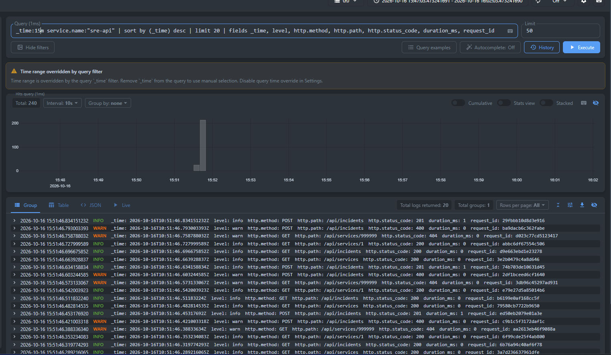
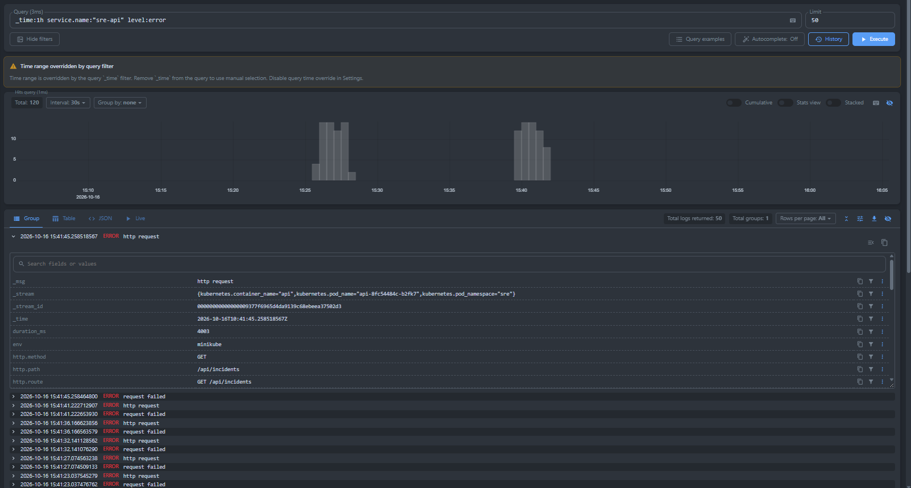
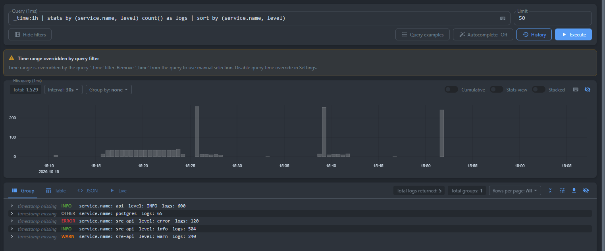
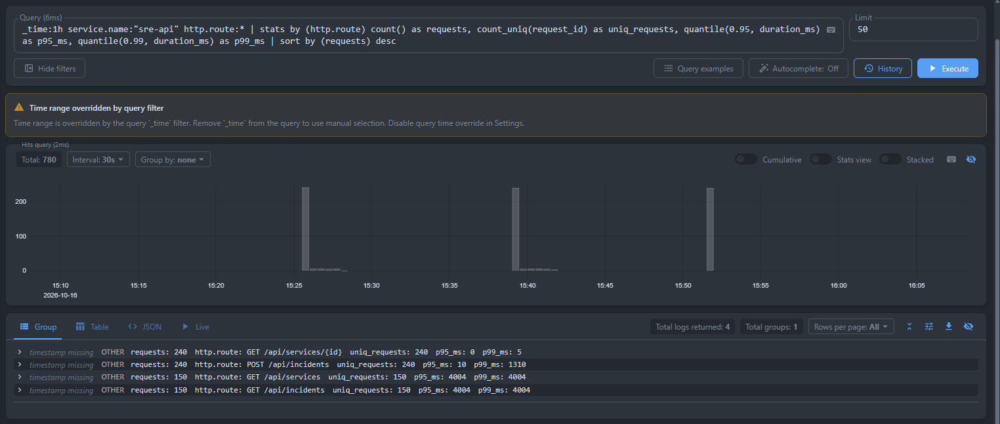
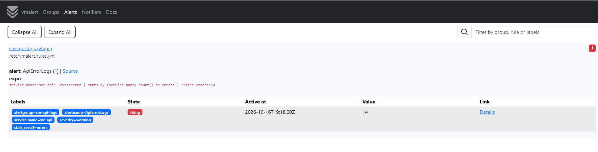

# Отчёт VictoriaLogs

Логи приложения SRE Incident Tracker (namespace `sre`) собираются в VictoriaLogs, развёрнутом в этом же кластере minikube (namespace `logging`). Манифесты лежат в `k8s/logging/`.

## 1. Логи приложения в JSON

API и мигратор пишут в stdout одну JSON-строку на событие. Схема полей:

| Поле | Пример | Назначение |
|---|---|---|
| `timestamp` | `2026-10-16T10:51:46.834Z` | время события, RFC3339, UTC |
| `level` | `info`, `warn`, `error` | уровень: 5xx → error, 4xx → warn, остальное → info |
| `message` | `http request`, `request failed` | сообщение |
| `service.name` | `sre-api`, `sre-migrate` | имя сервиса |
| `service.version`, `env` | `1.1.0`, `minikube` | версия и окружение (из ConfigMap) |
| `request_id` | `29fbb10d8d3e916` | уникальный id запроса, возвращается в заголовке `X-Request-ID` |
| `http.method`, `http.path`, `http.route` | `GET`, `/api/services/1`, `GET /api/services/{id}` | запрос; `route` — шаблон маршрута, чтобы группировать без id |
| `http.status_code`, `duration_ms` | `404`, `12` | результат и длительность |
| `err` | `failed to connect ... server misbehaving` | текст ошибки (в записях `request failed`) |

## 2. VictoriaLogs

VictoriaLogs single-node (`victoriametrics/victoria-logs:v1.52.0`) развёрнут как StatefulSet Service `victoria-logs:9428` (`k8s/logging/10-victoria-logs.yaml`). Доступ снаружи: `kubectl -n logging port-forward svc/victoria-logs 9428:9428`, vmui — `http://localhost:9428/select/vmui/`.

## 3. Доставка логов

Логи доставляет Vector, развёрнутый как DaemonSet (`k8s/logging/20-vector.yaml`): на каждой ноде он читает логи контейнеров из `/var/log/pods` (источник `kubernetes_logs`, только namespace `sre`), разбирает JSON-строку в отдельные поля, добавляет метаданные Kubernetes (`kubernetes.pod_name`, `container_name` и др.) и отправляет пачками в VictoriaLogs через Elasticsearch bulk API (`/insert/elasticsearch/`). Поля `message` и `timestamp` указаны как `_msg` и `_time`, а потоки (`_stream`) — по namespace, поду и контейнеру. Логи не-JSON контейнеров (postgres) проходят как есть.

Я выбрал такой способ, потому что приложению не нужно знать о способе доставки и месте хранения логов (оно просто пишет в stdout), а в поды не нужно добавлять sidecar-контейнеры. Vector сам разбирает формат контейнерных логов, обогащает записи метаданными и хранит позицию чтения на ноде, поэтому после перезапуска записи не теряются и не дублируются.

## 4. LogsQL-запросы в vmui

### 4.1. Сырые записи за последние 15 минут

```logsql
_time:15m service.name:"sre-api" | sort by (_time) desc | limit 20 | fields _time, level, http.method, http.path, http.status_code, duration_ms, request_id
```



Последние 20 записей API за 15 минут, свежие сверху. `fields` оставляет нужные колонки. Видно, что JSON разобран на отдельные поля: запросы `POST /api/incidents` со статусом 201 и `GET /api/services/1` со статусом 200 идут как `info`, а `GET /api/services/999999` (404) и `POST` с некорректным телом (400) — как `warn`.

### 4.2. Фильтр по полю `level`

```logsql
_time:1h service.name:"sre-api" level:error
```



Все ошибки API за час: 120 записей, два всплеска (около 15:26 и 15:40) — это два прогона нагрузки с остановкой PostgreSQL. Ошибки идут парами: `request failed` с текстом ошибки подключения к БД и `http request` со статусом 500. В развёрнутой записи видны `duration_ms` = 4003 (таймаут подключения к БД), `http.route`, `env` и метаданные пода.

### 4.3. Статистика по `service.name` и `level`

```logsql
_time:1h | stats by (service.name, level) count() as logs | sort by (service.name, level)
```



Количество записей по сервисам и уровням за час: `sre-api` — 504 `info`, 240 `warn` и 120 `error`. Строка `postgres` (65 записей) без `level`: этот контейнер пишет не JSON, а текст. Строка `api` / `INFO` (600 записей) — логи старой версии образа до перехода на новую схему полей (имя сервиса и уровень в верхнем регистре), они остались в хранилище за этот час.

### 4.4. Перцентили времени ответа и уникальные запросы по маршрутам

```logsql
_time:1h service.name:"sre-api" http.route:* | stats by (http.route) count() as requests, count_uniq(request_id) as uniq_requests, quantile(0.95, duration_ms) as p95_ms, quantile(0.99, duration_ms) as p99_ms | sort by (requests) desc
```



Для каждого маршрута API — число запросов, число уникальных `request_id` (совпадает с числом запросов, значит id уникальны), p95 и p99 времени ответа. В здоровом режиме быстрее всего `GET /api/services/{id}` (p95 = 0 мс, p99 = 5 мс), `POST /api/incidents` чуть медленнее (p95 = 10 мс, p99 = 1310 мс). У `GET /api/services` и `GET /api/incidents` p95 и p99 равны 4004 мс: на них пришлись запросы, пока PostgreSQL был остановлен, и они ждали таймаут подключения. Группировка идёт по `http.route`, а не по `http.path`, поэтому запросы к `/api/services/1` и `/api/services/999999` попадают в одну группу.

## 5. Бонус: алерт через vmalert

В кластере развёрнут vmalert (`k8s/logging/30-vmalert.yaml`) с правилом типа `vlogs`: `ApiErrorLogs` срабатывает, если у `sre-api` есть записи уровня `error`. Выражение правила проверено в vmui (vmalert сам добавляет окно `_time` по интервалу группы, 30 с):

```logsql
service.name:"sre-api" level:error | stats by (service.name) count() as errors | filter errors:>0
```



## 6. Состав сдаваемых файлов

```
k8s/logging/         манифесты VictoriaLogs, Vector, vmalert (и Grafana, не использовалась)
k8s/01-config.yaml   добавлены APP_ENV, APP_VERSION
internal/, cmd/      JSON-логгер и middleware запросов
scripts/             deploy-logging.sh, gen-traffic.sh, vl-query.sh
screenshots/         скриншоты vmui
```